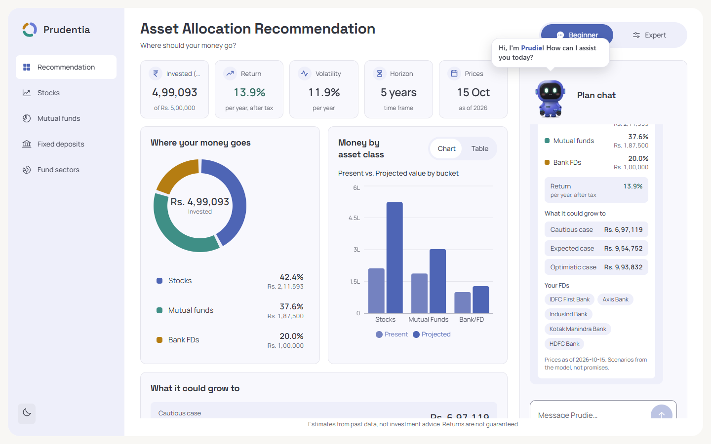
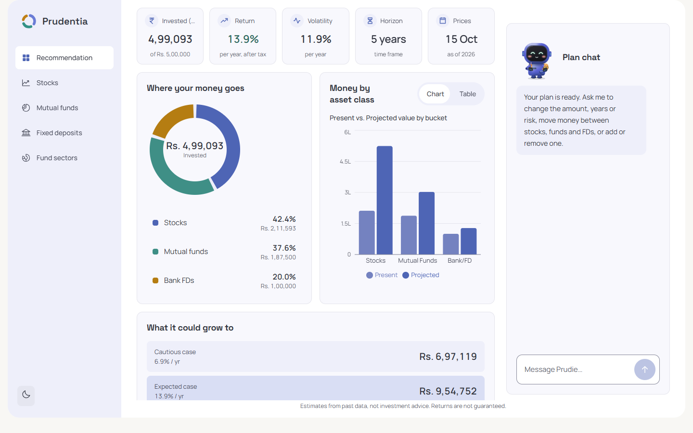
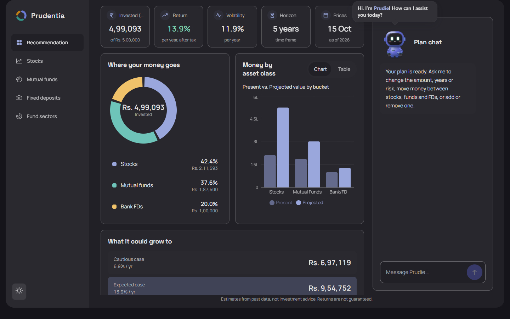
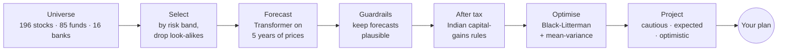
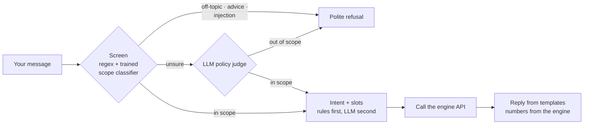
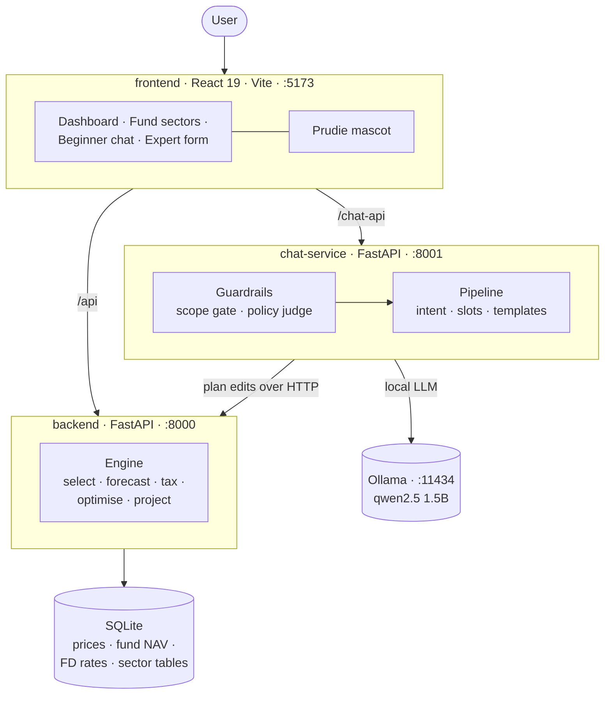
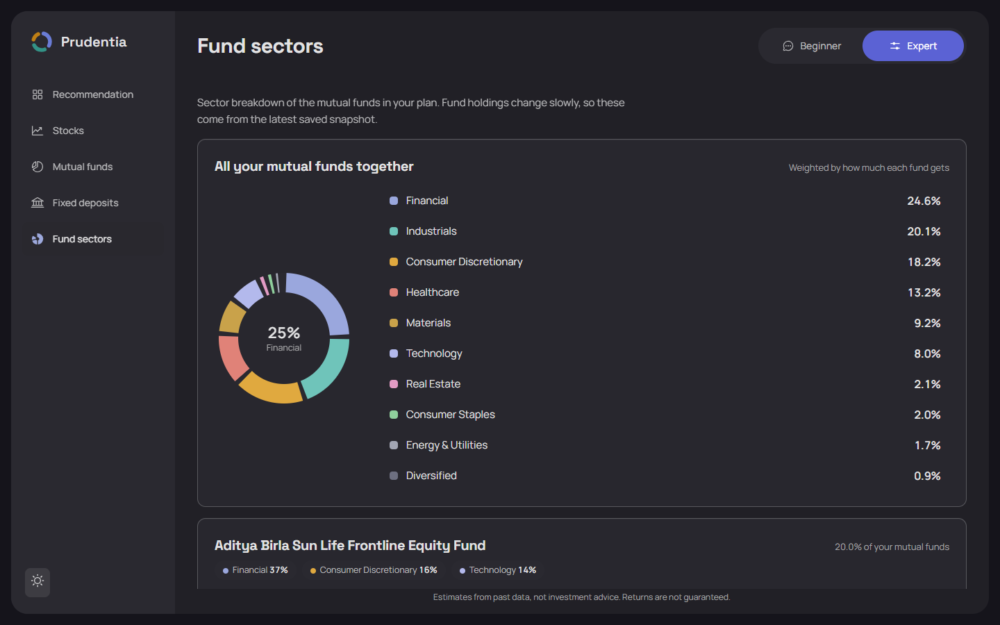
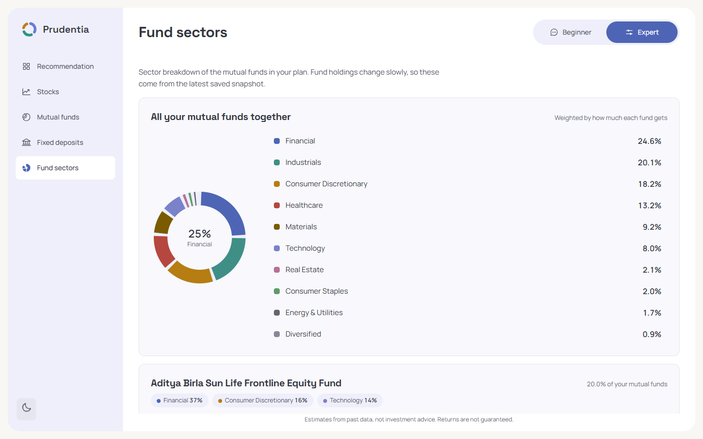

<div align="center">


# Prudentia

### Tell it how much, for how long, and how much risk you can stomach.<br/>It tells you where the money should go.

An asset-allocation recommender for Indian investors. It splits your money across **stocks, mutual funds and bank FDs**, projects what could happen, and lets you reshape the plan just by chatting with **Prudie**, a guard-railed AI assistant.

<br/>


[The problem](#-the-problem) · [What it does](#-what-it-does) · [How it works](#-how-it-works) · [Architecture](#-architecture) · [Results](#-results) · [Run it](#-run-it) · [API](#-api-at-a-glance)

<br/>



</div>

<br/>

## 🎯 The problem

Putting savings to work in India should be simple. It isn't.

- **Too many choices.** Hundreds of mutual fund schemes, thousands of listed stocks and dozens of banks, each with a different risk and return story.
- **"Risk" is vague.** Most people can't turn *"I can live with a bad year"* into *"put 42% in equities"*.
- **Advice is generic or expensive.** Rules of thumb ignore the person; personal advisers cost money and are out of reach for small investors.
- **AI chatbots are tempting but unsafe for money.** A language model that makes up a number, or gets talked into giving stock tips, is worse than no assistant.

## 💡 Why it matters

A first-time investor needs a *sensible starting point they can understand*, not a black box. Prudentia aims to give that starting point in under a minute: an allocation tied to the person's own risk tolerance, shown with an honest range of outcomes (including the bad case), and explained in plain language. It never promises returns, and it only ever answers questions about the plan itself.

## ✨ What it does

| | |
|---|---|
| **Two ways in** | **Beginner**: just say *"5 lakh for 5 years, medium risk"* to Prudie. **Expert**: a form with per-asset-class controls (sectors, fund categories, banks, your own split). Each mode keeps its own plan and chat. |
| **A real recommendation** | A split across stocks, mutual funds and FDs, the actual instruments inside each, an expected after-tax return, volatility, and cautious / expected / optimistic outcomes. |
| **Chat that edits the plan** | *"Move 10% from stocks to FD"*, *"remove mutual funds"*, *"make it 35% risk"*, *"add Kotak to my FDs"*. Understands English and Hinglish, replies in English. |
| **Look inside the funds** | A **Fund sectors** page: one combined sector donut for your whole mutual fund holding, plus a colour-coded breakdown per fund. |
| **Safe by design** | An off-topic, advice-seeking or prompt-injection message never reaches the planning logic. If anything fails, the assistant refuses rather than guesses. |

<div align="center">


<br/><sub>The dashboard in light and dark themes</sub>
</div>

## 🧠 How it works

The guiding rule: **code decides the money, the language model only reads English.** Every figure you see comes from the engine, never from the LLM.



1. **Select.** Your risk (0 to 100) maps to a volatility band: conservative (0–33), moderate (34–66) or aggressive (67–100). Instruments far outside the band are dropped, and near-duplicates (correlation above 0.85) are collapsed so the plan isn't five copies of the same bet. Up to 20 candidates per asset class survive.
2. **Forecast.** A small Transformer learns each candidate's return from five years of history. Forecasts are cached and refreshed daily.
3. **Guard.** A guardrail layer checks every forecast against the instrument's own history and clips implausible numbers before they can drive an allocation.
4. **Tax.** Returns are converted to what you'd keep after Indian capital-gains tax (equity LTCG/STCG rules), so the optimiser sees post-tax returns.
5. **Optimise.** Black-Litterman blends the forecast "views" with a historical prior, then mean-variance optimisation picks weights. Your risk sets the risk-aversion.
6. **Project.** Value today and in *N* years under cautious, expected and optimistic scenarios. FD banks are picked separately by FD-rate band with a round-robin, so the same bank isn't always first.

### How the chat stays safe



The assistant is allowed to do exactly one thing: help with stocks, mutual funds and FDs *inside this app*. Many messages are answered by plain code with no model call at all; the LLM is a fallback for unclear phrasing, and the engine's numbers are pasted into fixed templates. If Ollama is down, the judge returns bad output, or the engine is unreachable, the chat says so and refuses to guess.

## 🏗 Architecture



| Folder | What lives there | Stack |
|---|---|---|
| [`frontend/`](frontend) | The app: pages, charts, chat UI, motion | React 19, TypeScript, Vite, Tailwind v4, TanStack Query, Zustand, GSAP, Recharts |
| [`backend/`](backend) | Engine API, data download, universe lists, tests | FastAPI, PyTorch, PyPortfolioOpt, SQLAlchemy, pandas |
| [`chat-service/`](chat-service) | Chat endpoint, guardrails, evaluation tools | FastAPI, scikit-learn, Ollama, httpx |
| [`mascot/`](mascot) | Prudie, an SVG + spring-physics mascot (no images) | TypeScript, React |
| [`docs/`](docs) | Colour palette and screenshots | |

**Data.** Stock prices come from Yahoo Finance (NSE tickers) and mutual fund NAVs from [mfapi.in](https://www.mfapi.in), refreshed by `backend/download.py`. Bank FD rates are stored per bank. Fund sector tables are read from each fund's page and kept in `backend/data/mf_portfolios/manual_sectors.json`. Everything lives in one SQLite file, and the live app only ever *reads* it: no request waits on the internet.

<div align="center">


<br/><sub>Fund sectors: one combined donut, then a colour-coded breakdown per fund. Each sector keeps its colour everywhere.</sub>
</div>

## 📊 Results

### What the engine recommends

Three investors, each with **Rs. 5,00,000 for 5 years**, differing only in risk. Real output from this repository on data as of 15 Oct 2026:

| Risk | Stocks / Mutual funds / FDs | Expected return<br/>(per year, after tax) | Volatility | Cautious | Expected | Optimistic |
|---|---|---|---|---|---|---|
| **20** (conservative) | 29% / 33% / **38%** | 11.5% | 7.6% | Rs. 7.09 L | Rs. 8.64 L | Rs. 9.13 L |
| **50** (moderate) | 42% / 38% / **20%** | 13.9% | 11.9% | Rs. 6.97 L | Rs. 9.55 L | Rs. 9.94 L |
| **80** (aggressive) | 54% / 41% / **5%** | 16.1% | 16.6% | Rs. 7.18 L | Rs. 10.55 L | Rs. 10.99 L |

The pattern is the one you'd hope for: more risk means less FD, more equity, a higher expected return *and* higher volatility. A plan takes about **1 second** once the price cache is warm (about 3 seconds for the first one).

### How to read a plan

- **Plan around the cautious case**, not the expected one. It is the number to ask "could I live with this?" about.
- **FD share is your cushion.** It shrinks fast as risk rises, so check that the FD slice still matches how you feel about a bad year.
- **A small remainder can stay unallocated**; the dashboard shows exactly how much.
- **Everything is an estimate** from past data and a model. It is not investment advice and returns are not guaranteed.

### How safe is the chat?

Measured during development with a local `qwen2.5:1.5b-instruct` on hand-written message sets in English and Hinglish (in-scope requests, off-topic questions, stock-tip requests, prompt injections):

| Measurement | Result |
|---|---|
| Out-of-scope messages answered by the bare 1.5B model with no guardrails | **46% to 64%** |
| Same kind of messages through the guardrail layer, first run on an untuned held-out set (n = 54) | **9.1% leak**, 3.1% false block |
| Fresh 52-message set, run once (lightly tuned afterwards) | 0% leak, 0% false block |
| Model calls per message, on average | 0.65 (many turns are answered by plain code) |
| Latency | near zero for code-handled turns, roughly 2 to 7 s when the model runs (RTX 4050 laptop GPU) |

Small test sets mean small confidence: zero leaks in 52 messages is consistent with a true leak rate of up to roughly 6%. Treat these as engineering evidence, not a certification.

### Engineering checks

| Check | Result |
|---|---|
| Backend tests | 68 pass |
| Chat service tests | 258 pass |
| End-to-end chat flow against the live engine (plan, edit, rebalance, refuse, Hinglish) | 20 / 20 checks pass |
| Coverage of the universe | 196 stocks in 12 sectors, 85 mutual funds (72 with sector tables), 16 banks |

### Known limitations

Honest notes, so nobody is surprised:

- **Young funds can dominate.** A fund with only a few months of NAV history can score very well on a short window and hit the per-fund cap (40%). History length is not yet part of the selection score.
- **Conservative still leans small-cap inside the mutual fund bucket.** The split between asset classes responds to risk; the choice of funds within a class responds less.
- **The optimistic case sits close to the expected case.** Plan around the cautious case.
- **Sector tables are a snapshot** (16 Oct 2026), refreshed by hand rather than live.
- **The chat can lose context on multi-step moves** such as "move all money from MF and FD to stocks". This is being fixed.

## 🚀 Run it

You need **Python 3.11+**, **Node 20+**, **Git** and **[Ollama](https://ollama.com/download)**, plus about **3 GB** of disk space (PyTorch is the big one). Tested on Windows 11 with Python 3.14 and Node 24.

### 1. Get the code and the language models

```bash
git clone https://github.com/Kartikeya-Ambare/Prudentia.git
cd Prudentia

ollama pull qwen2.5:1.5b-instruct
ollama pull llama3.2:1b
```

Make sure Ollama is running (the desktop app starts it; otherwise run `ollama serve` in a terminal).

### 2. Start the three services

Use three terminals, one per service, each starting from the repository root.

**Backend** (the engine, port 8000). No database setup is needed: it ships with a ready SQLite file.

```bash
cd backend
python -m venv .venv
# Windows:        .venv\Scripts\activate
# macOS / Linux:  source .venv/bin/activate
pip install -r requirements.txt
python -m uvicorn backend.api.main:app --port 8000
```

**Chat service** (port 8001).

```bash
cd chat-service
python -m venv .venv
# Windows:        .venv\Scripts\activate
# macOS / Linux:  source .venv/bin/activate
pip install -r requirements.txt

# Windows (PowerShell):
$env:CHAT_ENGINE_MODE="http"; $env:CHAT_ENGINE_URL="http://127.0.0.1:8000"
# macOS / Linux:
# export CHAT_ENGINE_MODE=http CHAT_ENGINE_URL=http://127.0.0.1:8000

python -m uvicorn chat_service.main:app --port 8001
```

**Frontend** (port 5173).

```bash
cd frontend
npm ci
npm run dev
```

Open **http://localhost:5173** and say hello to Prudie. On Windows, once both virtual environments exist, `start-all.cmd` launches all three for you.

### 3. Check that it works

```bash
curl http://127.0.0.1:8000/health          # {"status":"ok"}
```

Then type *"I want to invest Rs. 5 lakh for 5 years with 50% risk"* in the chat. You should get a plan card with a split close to 42 / 38 / 20 within a few seconds. The first plan after a restart is the slowest while caches warm up.

### Run the tests

```bash
cd backend       && python -m pytest -q          # 68 tests
cd chat-service  && python -m pytest -q          # 258 tests, no Ollama needed
cd frontend      && npm run build                # type-check + production build
```

### Keep the data fresh

```bash
cd backend
python download.py                                # prices, fund NAVs, FD rates (several minutes, needs internet)

# After editing data/mf_portfolios/manual_sectors.json (fund sector tables):
python -I scripts/build_mf_sector_snapshot.py
python scripts/load_mf_sector_snapshot.py
python scripts/audit_mf_codes.py                  # sanity-check every fund's scheme code
```

### Configuration

Defaults work out of the box. Override only if you need to.

| Setting | Where | Default |
|---|---|---|
| `DB_HOST`, `DB_PORT`, `DB_NAME`, `DB_USER`, `DB_PASSWORD` | environment or `backend/.env` (see `backend/.env.example`) | empty `DB_HOST` uses the bundled SQLite file |
| `CHAT_ENGINE_MODE`, `CHAT_ENGINE_URL` | environment (chat service) | `fake` mode for tests, `http` to use the real backend |
| `VITE_API_URL`, `VITE_CHAT_URL` | `frontend/.env` (see `frontend/.env.example`) | `http://127.0.0.1:8000`, `http://127.0.0.1:8001` |
| Models and limits (amount 10,000 to 10 crore, 1 to 40 years, 300 characters, 1 message per second) | `chat-service/config.yaml` | as listed |

### Troubleshooting

| Symptom | Fix |
|---|---|
| Chat says the service is unavailable | Start Ollama, and check that the backend is on port 8000 |
| "Address already in use" | Another process holds port 8000, 8001 or 5173; stop it or pass a different `--port` |
| Plan takes many seconds every time | The backend was just started; the first plans warm the cache. Later ones take about a second |
| `pip install` is slow | PyTorch is a large download; it happens once per virtual environment |
| Stocks, mutual funds, FD and sector pages are locked | They unlock after your first plan |

## 🔌 API at a glance

| Method and path | Purpose |
|---|---|
| `POST /plan` | Create a plan: amount, years, risk, asset classes, banks, optional own split |
| `GET /plan/{id}` · `PATCH /plan/{id}` | Read a plan, or change any input and recompute |
| `POST /plan/{id}/rebalance` | Move part of one asset class into another |
| `GET /rebalance-check/{id}` | Has the plan drifted from what the engine would compute today? |
| `GET /banks` · `GET /data-status` | Bank list for FDs · how fresh the prices are |
| `GET /mutual-funds` · `/mutual-funds/{name}/sector-allocation` · `/sector-history` | Fund lookups and sector tables |
| `POST /api/chat` (port 8001) | One chat turn: `{ session_id, message }` returns a reply, the intent and, when relevant, a plan |

Interactive docs: **http://127.0.0.1:8000/docs**

## 🗂 Repository layout

```
Prudentia/
├── frontend/        React app (src/tabs, src/components, src/store, src/lib)
├── backend/
│   ├── backend/     api, forecasting, selection, data, orchestrator
│   ├── universe/    stock, bank and mutual fund lists + scheme codes
│   ├── data/        SQLite database, cached forecasts, fund sector tables
│   ├── scripts/     sector-data and scheme-code tools
│   └── tests/
├── chat-service/    chat_service (guardrails, engine client, pipeline), tests, evaluation tools
├── mascot/          Prudie
├── docs/            palette and screenshots
└── start-all.cmd    one-click start on Windows
```

---

<div align="center">

**Prudentia gives estimates from past data and a model. It is not investment advice, and returns are not guaranteed.**

</div>
